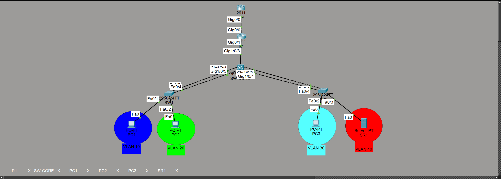

# Cisco Network Infrastructure Lab

**Cisco Packet Tracer · VLANs · Layer 3 switching · LACP · OSPF · DHCP · NAT/PAT · SSH**

[View the website walkthrough](https://dallasdeas.github.io/projects/network/)

## Project overview

I built a multi-VLAN network to practice how switching, routing, address assignment, and remote administration work together. I separated clients and a server into four VLANs, connected the access switches to a multilayer core, and used a router for upstream connectivity.

I documented the configuration results with eleven screenshots. My checks covered trunking, EtherChannel, route exchange, DHCP bindings, NAT translations, client-to-server connectivity, and an authenticated SSH session.

## Architecture

| Component | Role |
|---|---|
| Multilayer core switch | SVIs and inter-VLAN routing for VLANs 10, 20, 30, and 40 |
| Two access switches | Client and server attachment through LACP EtherChannel trunks |
| Router R1 | OSPF route exchange, DHCP bindings, NAT/PAT, and an upstream default route |
| Three client PCs | Connectivity and address-assignment tests across client VLANs |
| Server | Destination for client-to-server tests in VLAN 40 |

## Configuration and validation

| Area | What I checked | Recorded result |
|---|---|---|
| VLAN trunks | `show interfaces trunk` | Po1 carried VLANs 10 and 20; Po2 carried VLANs 30 and 40 |
| Link aggregation | `show etherchannel summary` | Two LACP bundles displayed SU with participating interfaces marked P |
| OSPF neighbors | Neighbor table and adjacency messages | R1's adjacency reached FULL |
| Routing | `show ip route` on the core and R1 | Connected VLAN routes on the core, learned VLAN routes on R1, and upstream default-route information |
| DHCP | `show ip dhcp binding` | Automatic leases in three client VLANs |
| NAT/PAT | `show ip nat translations` | Active ICMP translations toward the upstream test endpoint |
| Connectivity | Client ping tests | PC1 received four server replies; PC2 received destination-unreachable responses |
| Remote administration | SSH from PC1 to the core | Authenticated CLI access, followed by privileged EXEC and configuration modes |

## How I approached the checks

I worked from the network connections toward the services using them. I checked the trunks and aggregated links, inspected OSPF and the route tables, then reviewed DHCP and NAT entries. Finally, I compared client connectivity and tested SSH management.

The different ping results gave me a specific follow-up question: why could PC1 reach the server while PC2 could not? The saved output records the difference. My next check would be the applied ACL, its interface binding, and counters during a controlled repeat test.

## Screenshot walkthrough

### Cisco Packet Tracer topology

The topology connects an upstream router, R1, a multilayer core switch, two access switches, three client PCs, and a server. Color-coded endpoint groups identify VLAN 10 (PC1), VLAN 20 (PC2), VLAN 30 (PC3), and VLAN 40 (SR1).

### 802.1Q trunks and VLAN membership

The `show interfaces trunk` output on SW-CORE1 lists Po1 carrying VLANs 10 and 20 and Po2 carrying VLANs 30 and 40, with 802.1Q encapsulation and a trunking state.

### LACP EtherChannel verification

The `show etherchannel summary` output shows two Layer 2 port channels, Po1 and Po2, using LACP. Both display `SU`, and their member interfaces display `(P)`.

### OSPF adjacency reaches FULL state

The R1 neighbor table shows its OSPF neighbor at 192.168.0.2 on GigabitEthernet0/1. The console also records the adjacency transition from LOADING to FULL, after which the neighbor displays `FULL/BDR`.

### Core switch routing table

The multilayer core switch routing table includes connected VLAN interfaces for 192.168.10.0/24, 192.168.20.0/24, 192.168.30.0/24, and 192.168.40.0/24. It also displays an OSPF external default route via 192.168.0.1.

### R1 learns the VLAN networks through OSPF

R1's `show ip route` includes OSPF-learned routes for the four internal /24 networks, with next hop 192.168.0.2. Its default static route points toward 203.0.113.1.

### DHCP client bindings

The `show ip dhcp binding` output on R1 lists automatic leases for 192.168.10.11, 192.168.20.11, and 192.168.30.11, matching the client VLAN subnets.

### NAT/PAT translation entries

R1's `show ip nat translations` displays ICMP translations from inside-local 192.168.30.11 to inside-global 203.0.113.2, with 203.0.113.1 as the outside endpoint.

### PC1 successfully reaches the server

PC1 sends four ICMP echo requests to server address 192.168.40.40 and receives four replies. The output reports 0% packet loss.

### PC2 cannot reach the same server

PC2 also tries to ping 192.168.40.40, but its gateway at 192.168.20.1 returns `Destination host unreachable` for all four attempts.

### SSH connection to the core switch

From PC1, the command `ssh -l dallas 192.168.0.2` opens an authenticated CLI session on SW-CORE1. The session then enters privileged EXEC and global configuration modes.

## What I learned

I learned to check both sides of a routed path. A route on the core is one part of the path; the router also needs a route back to the client networks. The paired routing-table captures helped me review that relationship.

I also kept the verification commands tied to specific questions. Trunk output shows the VLANs being carried, EtherChannel output shows participating links, and translation entries show active NAT state. Reading them together gave me a clearer picture of the network.

## Next validation steps

- Capture ACL definitions, interface application, and counters during the PC2 test.
- Save the DHCP helper-address configuration alongside the existing lease evidence.
- Capture VLAN and SVI summaries to complete the addressing record.
- Save the VTY configuration to document the permitted remote-management transports.

[Back to all projects](https://dallasdeas.github.io/projects/)
